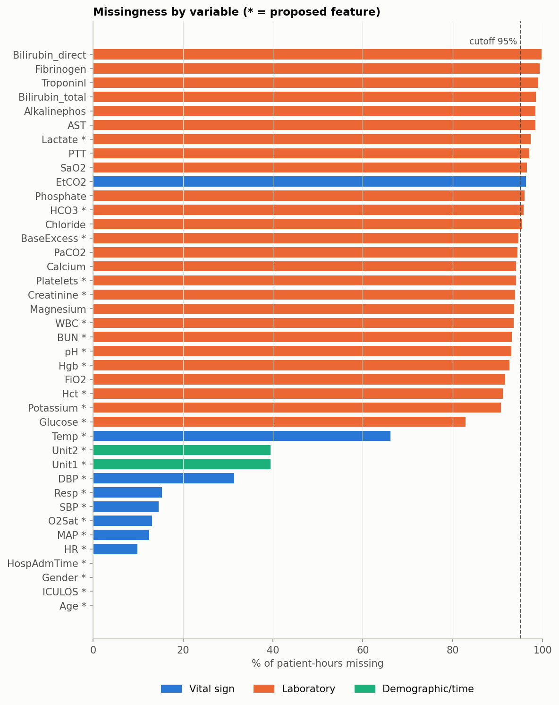
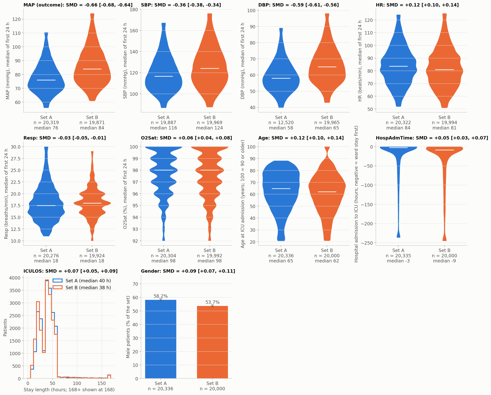
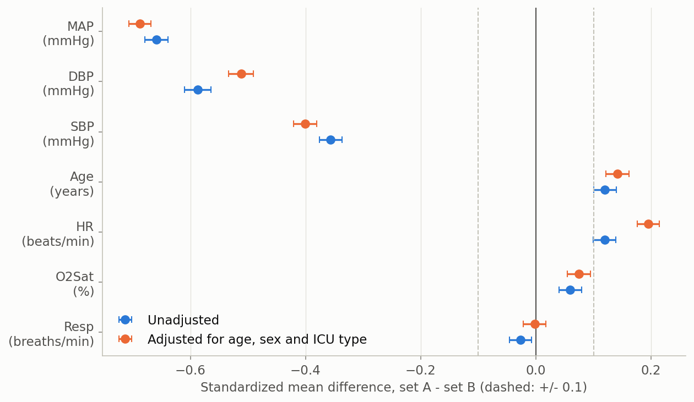
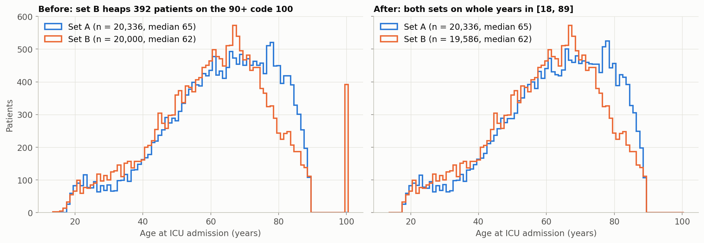
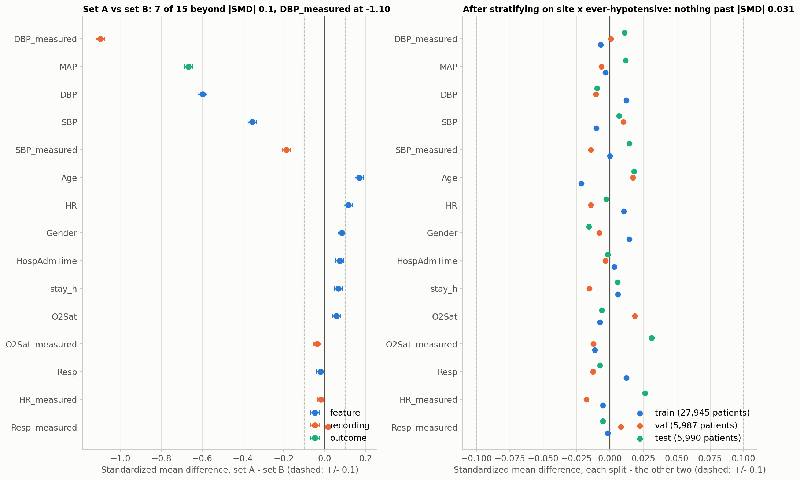

# Set A vs set B, and the preprocessing that follows from it

Working notes for the PhysioNet 2019 project. Covers what was added to the EDA notebook
(sections 6.1–6.4), what it found, and the PyTorch input pipeline built on top of it.

**Task**: predict whether MAP falls below 65 mmHg at any point in the next 6 hours.

---

## 1. Where everything lives

| Path | What it is |
|---|---|
| `EDA/PhysioNet2019_EDA.ipynb` | EDA notebook, sections 6.1–6.4 added (cells 26–33) |
| `datasets/physionet2019_all.pkl` | raw combined table, 1,552,210 rows × 40,336 patients |
| `datasets/physionet2019_harmonized.pkl` | grids equalised + age ranges aligned, 1,536,483 rows × 39,922 patients (§6.4) |
| `datasets/physionet2019_model_input.npz` | flat export for the model pipeline, 8 MB |
| `model/export_model_input.py` | writes the `.npz` from the harmonized pickle |
| `model/physionet_data.py` | PyTorch Datasets / DataLoaders + self-check |
| `model/batch_effect.py` | SMD batch-effect report on the model's own features |
| `EDA/09i_age_alignment.png` | age distributions before and after the age alignment |

**torch is now installed in `sc`** (2.14.1+cpu), so everything runs in one environment.

**One trap that came with it.** Importing torch *before* pandas breaks pandas:

```
ImportError: /lib64/libstdc++.so.6: version `GLIBCXX_3.4.29' not found
```

torch loads the old system `libstdc++`, and pandas' compiled extensions then resolve against it.
The env ships a new enough one, so the fix is to preload it. This is already set permanently in
`~/.local/share/jupyter/kernels/sc/kernel.json` (backup at `kernel.json.bak`):

```json
"env": {"LD_PRELOAD": "/home/mhanyu/.conda/envs/sc/lib/libstdc++.so.6"}
```

Restart the kernel once for it to take effect. Outside Jupyter, either prefix the command with
`LD_PRELOAD=/home/mhanyu/.conda/envs/sc/lib/libstdc++.so.6`, or just `import pandas` before
`import torch` — that order works unaided.

`drasi` (torch 2.8.0+cpu, Python 3.9) still works too, and is why the model input travels as
`.npz`: its numpy 1.23 cannot unpickle a numpy-2 pickle.

Running order:

```bash
SC=/home/mhanyu/.conda/envs/sc/bin/python
# 1. EDA notebook sections 6.1-6.4 (writes the harmonized pickle)
$SC model/export_model_input.py     # 2. export the model input
$SC model/batch_effect.py           # 3. batch-effect report
$SC model/physionet_data.py         # 4. pipeline self-check
```

---

## 2. What the EDA sections found

### Which variables are in, and why (`03_missingness_by_variable.png`)



The feature set is the block at the bottom of this chart — everything whose missingness stops
at DBP. There is a natural gap there:

| in the model | missing | | left out | missing |
|---|---|---|---|---|
| Age, ICULOS, Gender, HospAdmTime | 0.0% | | Unit1 / Unit2 | 39.4% |
| HR | 9.9% | | Temp | 66.2% |
| MAP *(outcome)* | 12.5% | | Glucose | 82.9% |
| O2Sat | 13.1% | | every other lab | 83–100% |
| SBP | 14.6% | | | |
| Resp | 15.4% | | | |
| **DBP** | **31.3%** | | | |

**Primary set vs backup.** The model to build first uses only what you specified:

| | primary (the model to run first) | exported as backup |
|---|---|---|
| vital values | SBP, DBP, HR, Resp | O2Sat |
| demographics | Age, sex, ICULOS | HospAdmTime |
| outcome | MAP — also an input channel, since its own past is the strongest predictor | |

`features="primary"` is the **default** in `physionet_data.py`; `features="all"` adds the backup
pair (16 → 19 channels for the masked variant). They are exported and harmonized so they are ready
if the primary model needs help, but they are not in the first model, and HospAdmTime in
particular should be added only with eyes open: it identifies the hospital on its own at
AUROC 0.714, more than all the primary features combined (0.706).

DBP is the last one in and the only borderline case: its missingness is **48.1% in set A against
13.9% in set B**, so the variable is present for roughly half of one hospital and essentially all
of the other. It is kept because blood pressure is the outcome's own family, but it is the first
thing to ablate if the A→B comparison looks odd.

Unit1/Unit2 were the next candidates and were left out for the same reason, more severely: 39.4%
missing overall, and *recorded* for 53% of set A against 70% of set B, so their missingness is
itself close to a site label. After that the jump to Temp (66.2%) and the labs (83%+) makes the
cutoff easy.

### 6.1 Baseline comparison (`09a_setAB_smd.csv`, `09c_setAB_violins.png`)

One row per patient, each vital summarised as the **median over the first 24 hours**
(`ICULOS <= 24`), so the comparison is "how sick on arrival" and is not weighted by stay length.
First observed value is the sensitivity version.

**SMD only — no hypothesis tests.** With ~20,000 patients per set every difference reaches
p < 1e-20, so the tests add nothing; `|SMD| > 0.1` is the line that matters. The hour-level rows
were removed for the same reason (see the design-effect note below).

Variables are the model's own: four vital values and three demographics. **MAP is reported as the
outcome**, not as a feature — the model predicts it.

Variables: five vital values (SBP, DBP, HR, Resp, O2Sat) and four demographics (Age, sex,
HospAdmTime, ICULOS as stay length), with MAP as the outcome. **O2Sat and HospAdmTime were added
later** — both are near the top of the missingness ranking (O2Sat 13.1%, HospAdmTime 0%), so they
cost almost nothing and give the model more to work with.

| variable | role | mean A | mean B | SMD (A−B) | site AUROC |
|---|---|---|---|---|---|
| MAP | **outcome** | 77.7 | 86.1 | **−0.67** | 0.683 |
| DBP | feature | 59.4 | 66.0 | **−0.60** | 0.670 |
| SBP | feature | 119.1 | 125.6 | **−0.36** | 0.601 |
| Age | feature | 62.6 | 59.9 | **+0.17** | 0.557 |
| HR | feature | 84.2 | 82.4 | **+0.12** | 0.549 |
| Gender (male) | feature | 58.2% | 54.0% | +0.08 | 0.519 |
| HospAdmTime | feature | −45.0 h | −52.8 h | +0.07 | **0.714** |
| ICULOS (stay length) | feature | 39.8 h | 38.2 h | +0.07 | 0.539 |
| O2Sat | feature | 97.7 | 97.6 | +0.06 | 0.532 |
| Resp | feature | 18.1 | 18.2 | −0.02 | **0.615** |

SMD formula, worked for MAP:

```
s_pooled = sqrt(((n_A-1)*sd_A^2 + (n_B-1)*sd_B^2) / (n_A+n_B-2))
         = sqrt((20318*11.392^2 + 19870*13.703^2) / 40188) = 12.588 mmHg
SMD      = (77.673 - 85.973) / 12.588 = -0.659
```

Read it as: a random A patient has a higher baseline MAP than a random B patient only **32%** of
the time (Φ(d/√2)), against 50% if the two sets were the same population.



Every variable we model, set A against set B. The violins are per-patient summaries over the
first 24 h; ICULOS is a count so it gets a histogram, and sex a proportion with its 95% CI. Each
panel's title carries its SMD and CI.

**Why patient-level and not patient-hour level.** Hours within a patient are correlated (MAP
ICC = 0.55, ~34 hours/patient), so the design effect is `1 + 33×0.55 ≈ 19` and the effective
sample size is ~20× smaller than the row count. Naive hour-level testing gives MAP t = −277;
after a cluster correction it is −63, and the patient-level test gives −70. The *difference* is
real either way — only the p-values and CIs break. This is why §6.1 is patient-level and
SMD-only.

### The batch effect on the model's own features (`model/batch_effect.py`)

The same 24 h baseline + SMD recipe, run on the `.npz` the model actually consumes, so the number
quoted in the report comes from the modelling data rather than the raw table. It also checks
whether our own 70/15/15 split added a second batch effect on top of the hospital one.

```
SMD says these are fine, the single-feature AUROC says otherwise - a shift in
shape rather than in the mean:
  Resp         SMD -0.021 but site AUROC 0.615
  HospAdmTime  SMD +0.073 but site AUROC 0.714

4 of the 9 model features exceed |SMD| 0.1: ['SBP', 'DBP', 'HR', 'Age']
mean |SMD| over the features   0.171
mean |SMD| over the indicators 0.271      <- recording practice is still the bigger batch effect
largest overall: DBP_measured at -1.098
outcome MAP: SMD -0.667

split     patients   % set B   largest |SMD| vs the rest
train       27,945     49.1%                       0.021
val          5,987     49.1%                       0.018
test         5,990     49.1%                       0.026
features above |SMD| 0.1 in any split: none
```

**Why there are two columns.** SMD compares means scaled by the pooled SD, so it is blind to a
shift that leaves the mean alone. `site_auroc` is the out-of-fold AUROC of a small boosted model
given that one variable and nothing else, computed on observed values only — 0.5 means the two
hospitals are indistinguishable from it, and anything well above that is a site marker whatever
the SMD says. Two features are caught only by the second column:

- **HospAdmTime, AUROC 0.714** — the strongest value-level site signal of any feature, while its
  SMD is a harmless +0.073. The mean is dominated by a tail reaching −5,367 h; the medians differ
  threefold (−3 h in set A vs −9 h in set B) and set B never records a positive value at all.
  Its fractional part alone gives 0.71 (set A piles on .97–.99, set B on .00) — rounding to whole
  hours removes that, and the remaining 0.72 is a genuine difference in how long patients wait on
  a ward before the ICU.
- **Resp, AUROC 0.615** — SMD −0.021 says the two sets are identical, but set B's respiratory
  rates are concentrated on a few integers where set A's are spread out.

Both stay in the feature set; they are flagged so the A/B scoring can be read with them in mind.

Per-feature, on the harmonized data (set A = 20,336, set B = 19,586):

| variable | role | mean A | mean B | SMD |
|---|---|---|---|---|
| DBP_measured | recording | 61.6% | 99.8% | **−1.10** |
| MAP | **outcome** | 77.7 | 86.1 | **−0.67** |
| DBP | feature | 59.4 | 66.0 | **−0.60** |
| SBP | feature | 119.1 | 125.6 | **−0.36** |
| SBP_measured | recording | 97.8% | 99.8% | **−0.19** |
| Age | feature | 62.6 | 59.9 | **+0.17** |
| HR | feature | 84.2 | 82.4 | **+0.12** |
| Gender | feature | 58.2% | 54.0% | +0.08 |
| ICULOS (stay length) | feature | 39.8 h | 38.2 h | +0.07 |
| Resp | feature | 18.1 | 18.2 | −0.02 |

So: the hospital batch effect is real and large (and **larger in the recording indicators than in
the physiology** — `DBP_measured` at SMD −1.10), while the split itself is clean. Outputs:
`model/batch_effect_site.csv`, `model/batch_effect_splits.csv`. The split reproduced in this
script is asserted identical to `physionet_data.make_splits`.

### 6.2 Is it just case mix? (`09d_setAB_adjusted.csv`, `09d_setAB_smd_forest.png`)

Each baseline variable regressed on `set + Age + Gender + ICU type` (ICU type as a 3-level factor
so patients with no unit recorded are kept).



**No.** For MAP the SMD goes from −0.66 to −0.69 after adjustment; age, sex and ICU type explain
−4% of the gap (adjustment slightly *widens* it). HR, SBP, DBP, Age all stay above |SMD| 0.1.
Only Resp — already negligible — is absorbed. So this is a hospital effect: different population,
different devices, or a different measurement protocol, not a different age/sex/unit mix.

### 6.3 Domain classifier (`09e_domain_classifier.csv/.png`, `09f_domain_coefficients.csv`)

Predict the site from the baseline record. 5-fold CV, out-of-fold AUROC.

| features | logistic | gradient boosting |
|---|---|---|
| values only (5 vitals + Age + Gender) | 0.702 | 0.955 |
| + recording indicators | 0.859 | 0.968 |

`recording` = the "was it measured at all in the first 24 h" indicators plus the ICU-type dummies.
Only two of them carry signal:

| indicator | measured in A | in B | AUROC alone |
|---|---|---|---|
| `DBP_measured` | 61.6% | 99.8% | 0.691 |
| `icu_recorded` | 53.2% | 69.5% | 0.582 |

So a single bit — "was DBP recorded" — is worth as much as all seven physiological values.

Overlap region (domain score 0.1–0.9) holds only ~50% of patients, so importance weighting would
need extreme weights; that is why it is not recommended.

### 6.4 The site fingerprint, and removing it (`09g_site_fingerprint.csv`, `09h_harmonization_check.csv`, `09i_age_alignment.png`)

The boosted model beat the logistic one by 0.25 **on identical columns**. That gap is not
physiology. Decomposition:

| | boosted AUROC |
|---|---|
| raw | 0.953 |
| → value grid and age range aligned | 0.851 |
| → also dropping the median-imputed DBP column | 0.756 |
| logistic on the same columns | 0.706 |

- **+0.10 number formatting.** Set A stores **fractional ages** (5,971 distinct values); set B
  stores **whole years**. "Age is a whole number" alone identifies the hospital for **99.5%** of
  patients. MAP is on a different grid too: whole numbers in 77% of A's hours vs 94% of B's, with
  A's remainder sitting on `.33`/`.67` (~17% of its hours; **not** explained by
  `DBP + (SBP−DBP)/3` — only 0.5% match).
- **+0.10 missingness leaking through imputation.** Median imputation puts 38% of set A patients
  at the *exact same* DBP value, which a tree reads as a site label — with no mask feature ever
  added. This is the dangerous one: it arrives silently through the imputer.
- **+0.05 genuine non-linear structure** a logistic model cannot use.
- **0.71 the real patient-state shift** — the number to quote in the report.

**The harmonization** (`harmonize_site_grid()`), which touches **only the variables we model**:

| variable | A raw | B raw | what is done |
|---|---|---|---|
| MAP, SBP, DBP, HR, Resp, O2Sat | `.0/.5` + thirds + quarters | `.0/.5` | round to whole units (≤0.5 change) |
| HospAdmTime | fractions pile on .97–.99 | fractions pile on .00 | round to whole hours |
| Age | fractions, nobody outside [18.11, 89.00] | whole years, 90+ = 100, 22 minors | round to whole years, **drop the 414 patients outside [18, 89]** |
| ICULOS, sex | whole hours, 0/1 | whole hours, 0/1 | nothing — already identical |
| Temp, EtCO2, labs | — | — | **left at full precision** (not in the model) |

Temp and the labs are deliberately untouched, but they do carry fingerprints of their own —
BaseExcess is 98% whole numbers in set A against 8% in set B, and 40% of set A's Temp values sit
on the 1/9 grid that whole Fahrenheit degrees produce. **Anything that adds them to the feature
set later has to harmonize them first.** Temp is 66% missing and Unit1/Unit2 39% (and recorded
for 53% of set A against 70% of set B, so their missingness is itself a site marker), which is
why they were not added alongside O2Sat and HospAdmTime.

**Age is aligned by exclusion, not by clipping.** Set A's ceiling is not top-coding: there is no
pile-up at 89 (the 0.2-year bins run 34–50 patients each right up to the edge, then stop), so the
90+ patients are simply absent from set A's cohort. Set B keeps them under the code 100 — 392
patients, with **nobody at all between 90 and 99**, where a smooth decay from the 85–89 counts
would predict ~28 real centenarians. Set A also has no minors while set B has 22. Clipping set B
onto 89 would heap 2.5% of set B on one year that set A barely occupies, so set B is cut to set
A's range instead: **414 patients dropped**, leaving 20,336 set A and 19,586 set B.
`09i_age_alignment.png`:



Worth carrying into the write-up: this is a difference in **who was admitted to the cohort**, not
only in how numbers were written down. Set B contains a 90+ group and a handful of minors that set
A systematically lacks; the alignment removes them rather than inventing a match.

**Rounding removes the fingerprint, not the shift.** MAP is still 8 mmHg lower in set A
afterwards — that difference is in the values themselves.

## 3. The PyTorch pipeline (`model/physionet_data.py`)

```python
from physionet_data import make_loaders
loaders, sets, stats, patients, splits = make_loaders(variant="masked", batch_size=64)
for batch in loaders["train"]:
    ...   # batch["x"], batch["event"], batch["origin"], batch["site"], ...
```

`variant` is one of `"masked"`, `"ffill"`, `"median"`; add `keep_mask=True` to any of them for the
hybrid. `features` is `"primary"` (default: SBP, DBP, HR, Resp + Age, sex, ICULOS, with MAP as
both target and input) or `"all"` (adds O2Sat and HospAdmTime). Everything else — splits,
standardisation, labels — is identical across variants and feature sets, so the runs are directly
comparable.

### Missing data: both strategies, three fillers

The point of the two headline variants is to answer one question — **is it better to tell the
model what is missing, or to fill it in?** — so both are built from the same splits and the same
training statistics and are directly comparable.

| `variant` | channels (primary / all) | missing cells become | keeps the mask? |
|---|---|---|---|
| `"masked"` | 16 / 19 | 0 in the value channel, **missingness recorded in the mask channel** | **yes** (+ time-since-last) |
| `"ffill"` | 6 / 7 | last observation carried forward; leading gap = training median | no (`keep_mask=True` for a hybrid) |
| `"median"` | 6 / 7 | the training median of that variable, always | no (`keep_mask=True` for a hybrid) |

**`"masked"` — leave it alone.** The NaN does not disappear, it moves into the `mask` channel.
A dense tensor has no "empty" state, and a NaN left in the input poisons the whole forward pass:
one NaN through a matmul gives NaN outputs and then a NaN gradient on *every* weight, which kills
the model in one batch. So the value channel gets 0 *after* standardisation — 0 is the training
mean, so it contributes nothing to the first layer's weighted sum — and the fact of the gap is
carried by two extra channels per vital: `mask` (1 = really measured) and the hours since that
variable was last measured. `(x=0, mask=0)` and a genuine reading that happens to equal the mean
`(x=0, mask=1)` stay distinguishable, which is the whole point. One real patient-hour:

```
RAW                              x (standardised)     mask
hour   MAP   SBP   DBP            MAP  SBP  DBP     MAP SBP DBP
  0    NaN   NaN   NaN           0.00 0.00 0.00      0   0   0     <- nothing measured
  1   65.0 124.0  43.0          -1.06 0.02 -1.50     1   1   1
```

Tree models are the exception: `HistGradientBoosting` takes NaN natively and splits on it, which
is exactly how the boosted domain classifier in 6.3 read the hospital off the missingness without
ever being handed a mask. This is what GRU-D style models expect, and it
is the only variant where the network can tell a measurement from a gap.

**`"ffill"` — the clinical default.** A value stays valid until it is replaced, which is how a
bedside chart is read. The gap before a patient's first measurement has nothing to carry forward,
so it takes the training median. The self-check confirms it behaves: 44 distinct filled values in
a batch, i.e. real earlier measurements rather than one constant.

**`"median"` — the baseline that makes the others earn their keep.** Every gap gets the same
number, with no memory of the patient (the self-check sees exactly 6 distinct filled values, one
per vital). If `ffill` does not beat this, the carry-forward is adding nothing.

**The hybrid.** `keep_mask=True` on `ffill` or `median` gives imputed values *plus* the mask
channels — the model sees both the filled number and the fact that it was filled. Often the
strongest option, and the one most exposed to the site leak below.

**Linear interpolation is deliberately not offered.** Filling a gap by interpolating uses the
measurement *after* it, which is a future value relative to the forecast origin and leaks the
horizon straight into the input. Fine for a retrospective description, wrong for this task.

**A warning that applies to every masked configuration.** `DBP_measured` is 61.6% in set A
against 99.8% in set B (SMD −1.10), so the mask channels carry the hospital. Any variant with
`keep_mask=True` can identify the site through missingness even on the harmonized grid — which is
a reason to score per site, and a reason the `masked` vs `ffill` comparison is worth running
rather than assuming.

Suggested run order: `median` (floor) → `ffill` → `masked` → `ffill` with `keep_mask=True`. Four
runs, same splits, and the spread tells you how much of the model's performance is coming from
the missingness pattern rather than the values.

### Batch contents

| key | shape | meaning |
|---|---|---|
| `x` | (B, T, C) | input channels, standardised |
| `mask` | (B, T, 5) | was this vital measured at this hour (6 with `features="all"`) |
| `y` | (B, T, 6) | future MAP in **mmHg** (not standardised), from raw observed values |
| `y_mask` | (B, T, 6) | was that future hour measured |
| `event` | (B, T) | the label: MAP < 65 within the next 6 h |
| `origin` | (B, T) | which hours are legitimate forecast origins — **mask the loss with this** |

The same filling happens on the label side: unmeasured future hours sit in `y` as 0 and are
flagged by `y_mask`. **Multiply the loss by `y_mask` (and by `origin` for the BCE)** — otherwise
the model is trained to predict MAP = 0 mmHg for every hour nobody measured.
| `static` | (B, 2) | Age, Gender, standardised (3 with `features="all"`: + HospAdmTime) |
| `site` | (B,) | 0 = set A, 1 = set B |
| `length`, `pad_mask` | (B,), (B, T) | real sequence lengths for `pack_padded_sequence` |

### The split: who makes it, what it balances, which seed

**The stratified sampling is plain numpy, not torch.** `make_splits()` uses nothing but
`np.random.default_rng(123)` — the stratification and the 70/15/15 cut both happen in numpy.
Torch only enters afterwards, for the `Dataset`/`DataLoader` wrapper and the shuffling *within*
the training loader, which never changes who is in which split.

**The two 123s are the same number, not the same generator.** `np.random.default_rng(123)` and
`torch.Generator().manual_seed(123)` produce different streams, and they control different
things:

| seed | where | controls |
|---|---|---|
| `np.random.default_rng(123)` | `make_splits()` | **which patients** land in train / val / test |
| `torch.Generator().manual_seed(123)` | `make_loaders()` | only the **order batches come out** of the training loader |

Verified: changing `torch.manual_seed` to 0 or 999 leaves the split byte-identical; changing the
numpy seed to 7 changes it. So the split is reproducible from the numpy seed alone, which is also
why `model/batch_effect.py` can rebuild it without importing torch — and it **asserts** the match
every time it runs:

```python
assert np.array_equal(mine[k], theirs[k])   # batch_effect.model_splits vs physionet_data.make_splits
```

**Stratified on `site × ever-hypotensive`, not on age.** Stratified sampling means: do not draw
the 70/15/15 from the 39,922 patients as one pool. Instead, cut the patients into groups first,
then take 70/15/15 **inside each group** and concatenate. Every group is then represented in
train, val and test in its original proportion, instead of being left to chance.

The two variables defining the groups are the hospital (`site`) and whether the patient's MAP
ever drops below 65 during the whole stay (`ever_hypotensive`). Crossing them gives four groups:

| stratum | patients | 70% → train | 15% → val | 15% → test |
|---|---|---|---|---|
| set A, never below 65 | 6,381 | 4,467 | 957 | 957 |
| set A, ever below 65 | 13,955 | 9,768 | 2,093 | 2,094 |
| set B, never below 65 | 11,790 | 8,253 | 1,768 | 1,769 |
| set B, ever below 65 | 7,796 | 5,457 | 1,169 | 1,170 |
| **total** | **39,922** | **27,945** | **5,987** | **5,990** |

Why these two and not others: **site**, because the whole point of this file is that the two
hospitals differ, and a split that happened to put more set B in test would mix that shift into
every comparison; **ever-hypotensive**, because it is the label — a split that gave test a higher
event rate would make the test score incomparable with validation.

Age is *not* a stratification variable. Nothing forces age to balance; it is only checked
afterwards, and it balances anyway (|SMD| 0.022 at worst) because 28,000 patients drawn at random
inside each stratum carry their age distribution with them. That is the general pattern: you
stratify on the few things you cannot afford to get wrong, then verify the rest.

- **By patient, never by row**, 70/15/15.
- 27,945 / 5,987 / 5,990 patients (39,922 after the age exclusion).
- Each split: **49.1% set B**, **54.5% ever-hypotensive**.
- Largest |SMD| of any feature against the other two splits: **0.021 / 0.019 / 0.031** — nothing
  above 0.1, so the split added no batch effect of its own.
- Asserted: no patient appears in two splits.



Left: the hospital difference, which no split can remove. Right: the same variables, each split
against the other two, after stratification — note the x scale, which runs to ±0.1 instead of
±1.1. The hospital effect is real and large; the split added nothing.

### Decisions baked in

- **A and B are mixed in all three splits**, as requested, but `site` travels with every batch so
  test metrics can still be split by hospital. Mixing spreads the shift across splits; it does
  not remove it.
- **Standardisation uses the training split only.** Val/test are transformed with training
  statistics and never contribute to them.
- **`ICULOS` is the running hour counter known at time t**, never the patient's total stay
  length. The final ICULOS summarises the future and would leak the horizon.
- **MAP is an input feature as well as the target** — lag-1 within-patient correlation is 0.41,
  so dropping its own past would throw away the strongest predictor.
- **`HospAdmTime` is clipped to [−720, +24] hours** (30 days before / 1 day after ICU admission),
  which touches 262 patients. Raw values reach −5,367 h, and standardised that tail would swamp
  the feature. This is a modelling choice and lives in `export_model_input.py`, separate from the
  site alignment in the notebook.
- Targets come from **raw observed MAP**, never from forward-filled values, so the `ffill`
  variant cannot leak an imputed number into its own label.
- Tested in the self-check: forward fill never looks ahead; `y[t, h-1] == MAP[t+h]` for h = 1..6.

### Label definition for MAP < 65

Three knobs on `PhysioNetSequences`, measured on the test split:

| window | event rule | exclude already <65 | origins | rate | set A | set B |
|---|---|---|---|---|---|---|
| **complete** | **any** | **yes** (default) | **114,430** | **22.3%** | **29.7%** | **14.2%** |
| complete | any | no | 129,436 | 29.3% | 38.2% | 18.2% |
| complete | sustained | yes | 114,430 | 8.5% | 12.1% | 4.5% |
| any | any | yes | 174,062 | 19.6% | 26.5% | 12.5% |

- **`exclude_hypotensive_now=True`** — without it, the extra 7 points of prevalence are almost
  entirely "already below 65 and stays below", which the model reads straight off the current
  MAP. Good AUROC, no clinical value. The real task is early warning on a currently-stable
  patient.
- **`window="complete"`** — with `"any"`, a window where only 1 of 6 future hours was measured is
  labelled 0 even if a drop happened in the unmeasured hours, and the missingness is informative
  (unstable patients get measured more). Costs 34% of origins (174,062 -> 114,430); worth it.
- **`event_rule="sustained"`** (2 consecutive hours below) is the endpoint a clinician would act
  on, and a much harder problem at 8.5%. Report both.

---

## 4. Open items / recommendations

1. **Report every metric per site.** Base rates differ 2× (29.7% vs 14.2%). AUPRC's floor *is*
   the prevalence, so a pooled AUPRC averages two different problems. A single probability
   threshold picked on pooled validation will over-alarm in A and under-alarm in B — choose the
   operating point per site, or at least show per-site calibration.
2. **Do not rebalance to 50/50.** Keep the natural prevalence and work with the probability
   output.
3. **Two modelling routes, run both.**
   - *Direct classifier*: RNN → per-hour sigmoid, BCE masked by `origin`. Best raw discrimination.
   - *Gaussian forecast + derived probability*: M1/M2/M3 forecast the 6 future MAP values, then
     P(min < 65) by Monte Carlo from the predictive distribution. This is the family the whole
     EDA justifies (ICC 0.55, AR(1) ρ = 0.41), it marginalises over unobserved future hours — so
     it can use the `window="any"` origins and recover the ~60k windows the complete rule
     discards — and the threshold stops being baked in (MAP<60 or the age-specific rule need no
     refit).
4. **Ablate the mask channels in the A→B comparison.** `DBP_measured` is near enough a site
   label; a masked-variant model can identify the hospital through missingness even on the
   harmonized grid.
5. **A → B external validation is still unmeasured.** Once a model exists: fit on A, report the
   same metric under CV within A and on all of B; the difference is the cost of the shift.
   Refitting inside B separates "B is shifted" from "B is simply harder to predict". Note this
   conflicts with the pooled-training decision — if you keep pooling, run the A→B split once as a
   diagnostic rather than as the main evaluation.

---

## 5. Backups

`EDA/PhysioNet2019_EDA.ipynb.bak` … `.bak5` are snapshots taken before each round of edits to
the notebook, newest last. `~/.local/share/jupyter/kernels/sc/kernel.json.bak` is the kernel spec
before the LD_PRELOAD line was added. Delete when you no longer want them.
